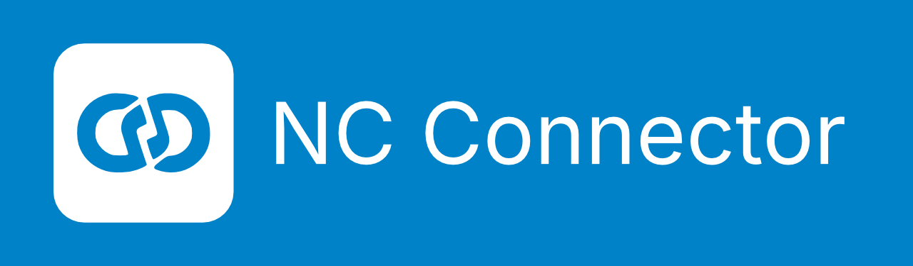
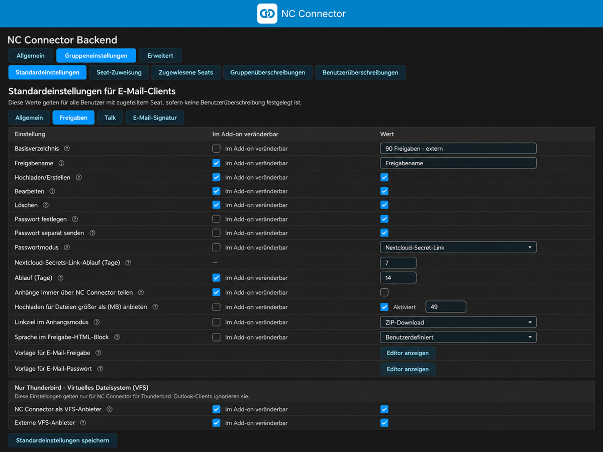
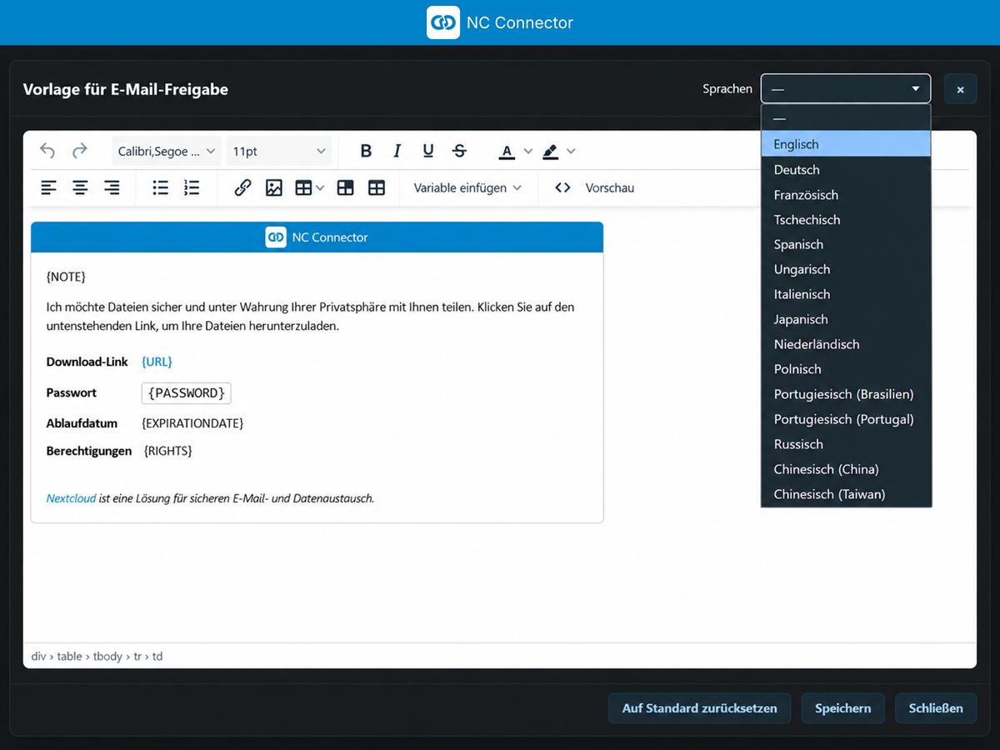
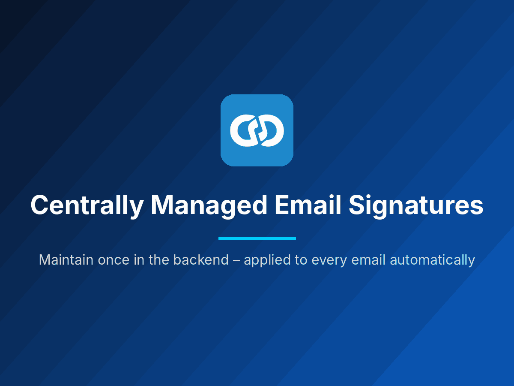
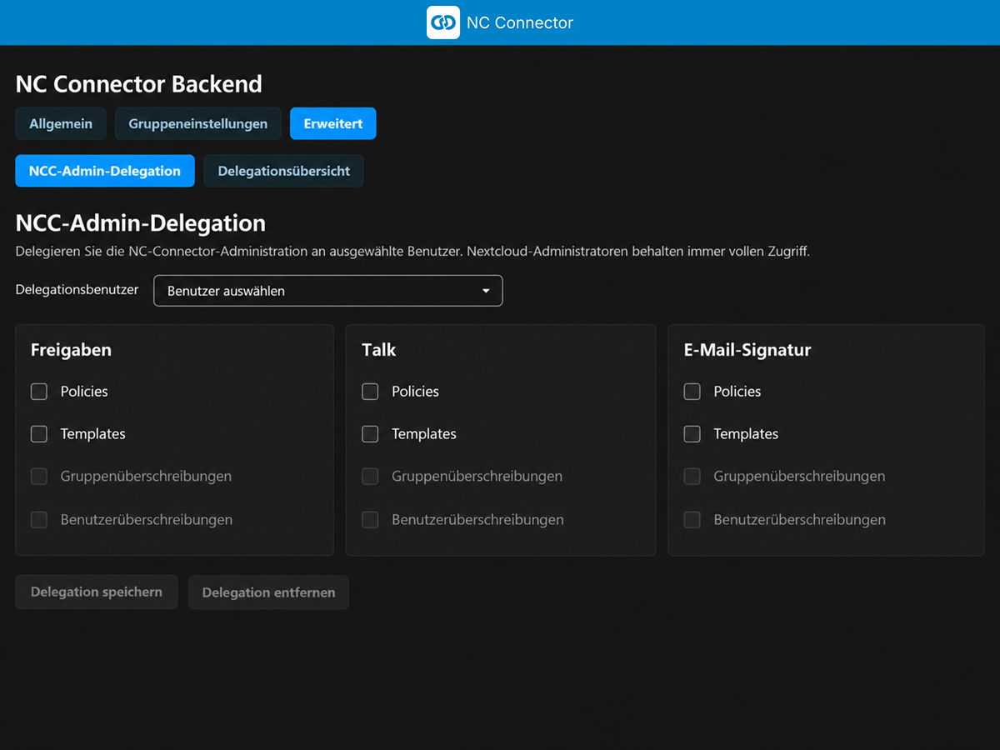

# NC Connector Backend

  <strong>Your team's NC Connector settings, managed in Nextcloud.</strong> 
  Set shared defaults, design branded templates and signatures, and give administrators control without configuring every mailbox by hand.

  <a href="https://apps.nextcloud.com/apps/ncc_backend_4mc"><strong>Install the free backend</strong></a>
  &nbsp;·&nbsp;
  <a href="https://github.com/nc-connector/Server_Backend/blob/main/Doku/admin.md#table-of-contents">Admin guide</a>
  &nbsp;·&nbsp;
  <a href="https://nc-connector.de/">Website</a>

The optional Nextcloud app for centrally managed [Thunderbird](https://github.com/nc-connector/NC_Connector_for_Thunderbird) and [Outlook Classic](https://github.com/nc-connector/NC_Connector_for_Outlook) installations. Start with **one free, full-featured Community seat** and add seats as your team grows.

File sharing, **My Nextcloud**, Talk, and attachment rules also work without the backend using local client settings.

---

## See it in action

Manage settings in Nextcloud and use them in your mail clients. Expand a section to see the workflow.

<strong>Set shared defaults and decide what users can change</strong>

Choose defaults for sharing, password protection, expiration, attachment rules, and Talk meetings. Keep selected settings editable in the add-on or lock them centrally. Group and user overrides handle teams and individual exceptions without changing the defaults for everyone.

  

Forced user overrides take precedence over forced group overrides, then defaults. Among matching groups, the lowest numeric priority wins.

[Policy precedence](https://github.com/nc-connector/Server_Backend/blob/main/Doku/admin.md#51-policy-precedence) · [Editable settings](https://github.com/nc-connector/Server_Backend/blob/main/Doku/admin.md#52-editable-in-add-on)

<strong>Give shares and meeting invitations your own branding</strong>

Edit templates for share blocks, separate password emails, and Talk invitations. Add your logo, adjust the wording, and insert variables for links, passwords, permissions, and other workflow details. Preview the result before saving it for your users.

  

[Template setup and operation](https://github.com/nc-connector/Server_Backend/blob/main/Doku/admin.md#56-template-operation)

<strong>Keep your team's email signatures consistent</strong>

Design a signature centrally and fill it with Nextcloud profile details and per-user fields. Choose when it appears in new messages, replies, and forwards. The mail client applies it to matching sender identities; unrelated accounts keep their own signatures.

  

*Shown in Thunderbird. Centrally managed signatures are also available in Outlook Classic.*

Replace the example address and legal text before rollout. The sender address must match the seat user's effective signature email address.

[Managed signature setup](https://github.com/nc-connector/Server_Backend/blob/main/Doku/admin.md#55-email-signature-settings)

<strong>Delegate administration without granting full Nextcloud admin rights</strong>

Let selected colleagues maintain Share, Talk, or signature settings, templates, and overrides. Assign only the areas and tasks they need. Delegated administrators work from their personal Nextcloud settings and see only their permitted controls.

  

Seat assignment, licensing, and delegation management remain with full Nextcloud administrators.

[Delegated administration](https://github.com/nc-connector/Server_Backend/blob/main/Doku/admin.md#6-delegated-administration)

## One full-featured seat included.

The backend includes **one free Community seat**, assigned to one Nextcloud user. That seat unlocks the **same seat-based features as paid seats**; paid plans add seats for more users.

- Central settings, administrator locks, and delegated management
- Low-touch enterprise rollout with user-friendly sign-in through the client deployment options
- Managed signatures, custom templates, and branding
- Room and resource picker with filters and availability checks in Thunderbird and Outlook Classic
- Separate password delivery by email or expiring Nextcloud Secrets links; Secrets links also require the Secrets app
- Additional storage sources **in Thunderbird**, using compatible provider add-ons

Personal seat-based features in the mail clients need valid backend access and an active assigned seat. A seat belongs to a **Nextcloud user**, not a device. Administrator rights alone do not grant personal seat features; administrative access does not itself require a seat.

Room selection and booking happen through the mail client and Nextcloud calendar, not through a separate backend booking service. Save and synchronize the event, then check the resource's response.

[Community and paid seats](https://github.com/nc-connector/Server_Backend/blob/main/Doku/admin.md#42-community-and-pro-mode) · [Plans and licensing](https://nc-connector.de/preise-lizenzierung/)

## Get started

1. Install and enable **NC Connector for mail integration** from the [Nextcloud App Store](https://apps.nextcloud.com/apps/ncc_backend_4mc).
2. Open **Administration settings → NC Connector Backend** and choose Community mode. For a paid license, select Pro, save the license credentials, and select **Sync now**.
3. Review the defaults under **Group Settings → Default Settings**. Replace example branding and signature details before enabling them for users.
4. Assign the first seat to a pilot user. Connect the Thunderbird or Outlook add-on to Nextcloud as that same user.
5. Test sharing and every enabled Talk, signature, and policy workflow before extending the rollout.

The backend provides settings and access information; it does not install the mail add-ons or configure client accounts. Use the [Thunderbird rollout guide](https://github.com/nc-connector/NC_Connector_for_Thunderbird/blob/main/docs/ADMIN.md#enterprise-rollout) or [Outlook rollout guide](https://github.com/nc-connector/NC_Connector_for_Outlook/blob/main/docs/ADMIN.md#enterprise-rollout) for managed client deployment and sign-in.

[Installation and first rollout](https://github.com/nc-connector/Server_Backend/blob/main/Doku/admin.md#3-installation-and-first-rollout) · [Pilot acceptance checklist](https://github.com/nc-connector/Server_Backend/blob/main/Doku/admin.md#34-pilot-acceptance)

### What you need

- **Nextcloud 32 through 36** with **PHP 8.3 or newer**
- HTTPS for production access and regularly running Nextcloud background jobs
- A Nextcloud administrator for installation and initial configuration
- A maintained **NC Connector for Thunderbird** or **NC Connector for Outlook Classic** release
- **Files Sharing** for file shares, **Talk** for online meetings, and optionally **Secrets** for expiring password links

Client workflows can have additional requirements. Room and resource booking needs a suitable Nextcloud calendar and scheduling setup; Outlook Classic also needs CalDAV Synchronizer. The new Outlook is not supported.

[Platform and network requirements](https://github.com/nc-connector/Server_Backend/blob/main/Doku/admin.md#2-requirements-and-network-access)

## Documentation

- [Admin guide](https://github.com/nc-connector/Server_Backend/blob/main/Doku/admin.md#table-of-contents): installation, policies, seats, delegation, updates, and troubleshooting
- [Client rollout dependencies](https://github.com/nc-connector/Server_Backend/blob/main/Doku/admin.md#7-client-rollout-dependencies) · [Backup and recovery](https://github.com/nc-connector/Server_Backend/blob/main/Doku/admin.md#93-back-up)
- [Development guide](https://github.com/nc-connector/Server_Backend/blob/main/Doku/development.md) · [HTTP API](https://github.com/nc-connector/Server_Backend/blob/main/Doku/endpoints.md)
- [Changelog](https://github.com/nc-connector/Server_Backend/blob/main/CHANGELOG.md) · [Supported languages](https://github.com/nc-connector/Server_Backend/blob/main/Translations.md) · [Screenshots](https://github.com/nc-connector/Server_Backend/tree/main/screenshots)
- [License](https://github.com/nc-connector/Server_Backend/blob/main/LICENSE.txt) · [Third-party components](https://github.com/nc-connector/Server_Backend/blob/main/VENDOR.md)

## Open source, with clear data paths

Policies, templates, seats, and delegation settings stay in your Nextcloud database. The backend does not store mail content or attachments. File sharing and Talk use your own Nextcloud; file contents are not relayed through an NC Connector-hosted service.

A daily version check sends the product, installed version, channel, and a daily pseudonymous identifier. License checks are separate; Community mode does not contact the license endpoint. External images used in templates may be fetched for editor previews.

[Network paths and transmitted data](https://github.com/nc-connector/Server_Backend/blob/main/Doku/admin.md#24-network-paths) · [Trust and transparency](https://nc-connector.de/vertrauen-transparenz/) · [Public roadmap](https://github.com/orgs/nc-connector/projects/1)

## Help and feedback

Found a bug or have a feature request? [Open an issue](https://github.com/nc-connector/Server_Backend/issues). Include your Nextcloud, PHP, backend, and affected client versions, plus steps to reproduce. Remove license keys, credentials, private links, and personal information from logs and screenshots.

For rollout questions, [get in touch](https://nc-connector.de/kontakt/). If NC Connector helps you, a GitHub star helps others find it.
